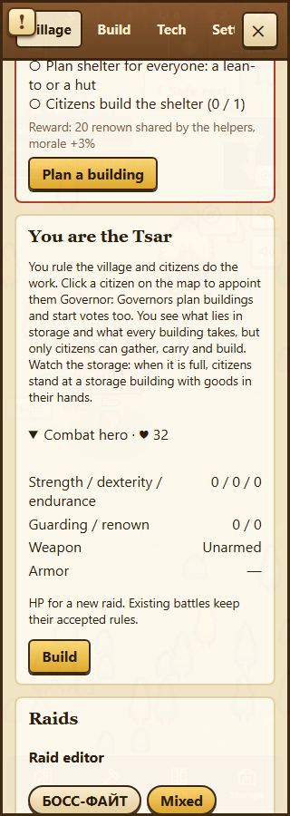

# Общий боевой профиль в рейде · T015/T031, частичный A14

21.10.2026. Продолжение PR89. Царская должность не даёт новых рейдовых
80 HP/8 урона. В этой поставке общий профиль введён в рейдах; данж ещё
использует прежний профиль Воеводы. Весь A14 и Дезертовия1.0 не завершены.

## Точки интеграции и совместимость

`RoyalCombatState` сохраняет характеристики, навыки, славу, оружие, броню,
стрелы, заточку и остатки переносимых вещей. Новый отдельный герой начинает
с тех же нулевых характеристик, что `CharacterCreation.Create`, без прибавки
за должность. Если у аккаунта уже есть житель этого царства, используются
его настоящие характеристики и вещи; прежний прогресс не сбрасывается.
Адаптер `RoyalCombatBody` переиспользует Citizen/CombatRules, не добавляя
фиктивную строку жителя. Источник тела фиксируется в бойце: появление или
удаление профиля жителя не заменяет уже допущенное тело новым здоровым.

`RaidBalance.Prepare` записывает CombatRulesVersion1 для новых объявлений.
При вступлении версия копируется в RaidFighter и переносится вместе с HP
между волнами. Существующие объявления получают0, старый JSON бойца без
ключа остаётся legacy. Их80 HP/8 урона и существующее здоровье не пересчитываются.
Значение версии устанавливает сервер; настройки рейдового редактора его
не выбирают. Новые жильцы используют ту же версию без изменения старого HP.

Новый царь проходит `FightCitizen`: те же32+4×Endurance HP, сила от статов,
навыка/оружия/заточки, броня, дальность, задержка удара, реальные стрелы
и эффект приготовленного блюда. Снаряжение берётся тем же CombatRules.Arm
из настоящих рук/склада. На нуле HP герой выключается и получает конечное
ранение; повторный приказ не восстанавливает HP. Опыт, слава и износ считаются
один раз при исходе рейда; Dcoin, подписка и права казны не участвуют в формуле.

В старом живом бою лук списывал одну стрелу, но требовал наличия двух.
Для новых бойцов1 хватает одной настоящей стрелы; это относится к обоим
ролям. Старые рейды и абстрактные legacy столкновения сохраняют прежние
правила. Каталог не переименован, агрегатный расход2 не заменён глобально.

## Лечение и меню

В бою действует прежний BattleActions:20% HP, cooldown60s и requestId,
один реальный расход лекарства. После выбывания новое `/tsar/heal` снимает
ранение существующим CombatRules.Heal. EconomyReceipt защищает параллельный
запрос и повтор после потерянного ответа; он не списывает второе лекарство.
Источники лечения — настоящие личные/переносимые вещи при существующем
профиле жителя и общий склад по тем же правилам. Данж и активный рейд
проверяются существующим допуском; состояние отдыха сохраняется. Лечение ранения не воскрешает бойца,
выбывшего из данного боя. Платная внешняя больница этим действием не отключается.

Нативное пребывание в больнице завершается вместе с конечным ранением,
а не блокирует ходьбу навсегда оставшимся HospitalizedAt. Совпадающий эпизод
старого профиля жителя согласует срок и не получает второй флаг награды
за спасение. Полный социальный сценарий старых alias ещё требует сквозной
проверки вместе с восстановлением/данжами.

В существующем меню царя добавлена свёрнутая RoyalCombatSheet: HP нового
рейда, статы, охрана/слава, оружие/броня/стрелы и кнопка лекарства при ранении.
Числа актуального боя по-прежнему показываются из RaidFighter. Карточка
не занимает постоянную панель мира; повтор ошибочного лечения сохраняет
requestId. Личные остатки лекарств не добавляются в публичное состояние.
Это функциональная карточка существующего оформления, не законченная
графика всех меню «Живое царство».

## Миграция и сохранность

52 / `20261021041138_MortalRoyalCombat`: nullable RoyalCombat JSON и версия
рейда с default0; новые nullable поля бойцов читают старый JSON. Down
отказывается удалить сохранённый профиль или объявление новой версии.
В отдельной БД проверены старые полные строки,37/80 HP,19 урона, сохранение
опыта/заточки/последней стрелы/прочности4, оба запрета Down и допустимый
обратный переход после явного удаления только выдуманного состояния теста.

Общая локальная игра обновлена51→52 после backup
`/tmp/foundation-before-restart-20261021T043127Z.dump`. Совпали все сравниваемые
старые строки28 жителей,4 миров,21 кошелька,4 экономик,3 данжей и1 рейда.
Только две новые колонки исключены из сравнения старого содержимого; новые
профили не создались сами. Другие таблицы этим сравнением не покрываются.
Публичная игра и бот не обновлялись.

## Проверки и границы готовности

669 Domain PASS: равные роли без оружия/с копьём/с последней стрелой дают
равные HP, урон, защиту и cooldown; legacy версия не меняется, KO конечен,
опыт/износ однократны, источник тела не подменяется, лечение и срок больницы.
Две старые бухгалтерские фикстуры получили постоянную местность: случайный
пруд под выдуманной мастерской больше не подменяет проверку себестоимости.

API по этапам:13 PASS (4 новых рейдовых, миграция и8 допуска), затем5 PASS
после конечного срока больницы; это14 разных сценариев, не18. Дополнительный
прогон двух граничных сценариев фиксируется отдельно. Первый новый прогон
1 PASS/3 FAIL выявил отсутствующий общий склад в выдуманных фикстурах:
Store возвращал0; склад добавлен и фактическая доставка проверяется явно.
Это не объявляется ошибкой или исправлением игрового бесплатного лечения.

14 browser PASS:4 новых RU/EN сценария карточки/повтора requestId на320px
в двух проектах и10 соседних управления/HUD. TypeScript/Vite/oxlint PASS.
Настоящее меню локальной игры на320px также проверено:32 HP, изначально
свёрнуто, без оружия, открытие не меняет профиль,0 ошибок страницы.

Точные результаты и SHA — MORTAL_HEROES_RAID_VERIFICATION_1_0.json.
Полный CI нового коммита требуется отдельно. Следующий шаг — такой же
сохранённый профиль в данже, адресное снаряжение/класс и однократный возврат
на cancel/ранении/выходе/restart. Группа/припасы/снабжение, общий баланс,
социальное спасение, нагрузка и физические телефоны остаются в DAG;
новую смерть и потери рюкзака без решения не вводить.
